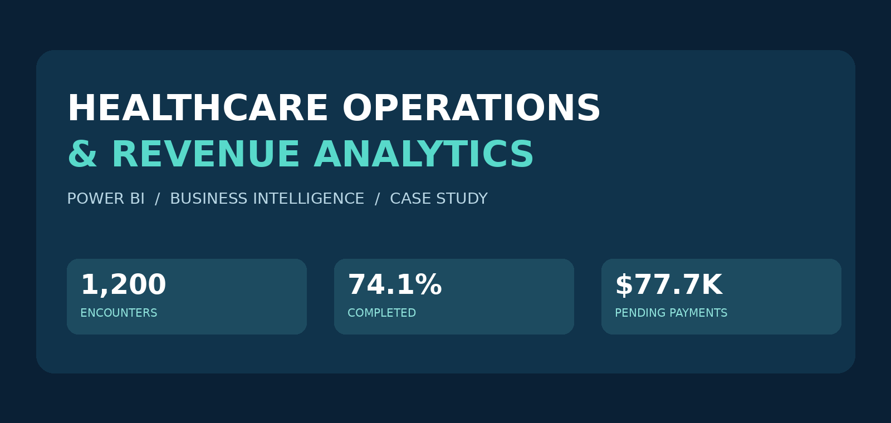

# 🏥 Healthcare Operations & Revenue Analytics | Power BI

### Connecting patient access, operational performance and revenue-cycle risk



  

> **Business question:** Where are patient demand, incomplete visits and unpaid claims creating operational pressure or financial exposure—and which areas should leaders prioritize?

**Executive snapshot:** **1,200 encounters** · **74.1% completed** · **10.0% no-show rate** · **$465,896 billed** · **$77,737 pending**

## Executive overview

This end-to-end Power BI project explores how patient appointments, provider workload, experience metrics, insurance claims and payment outcomes relate to operational efficiency and revenue-cycle performance. The deliverable is a six-page Power BI report with KPI cards, department comparisons, follow-up and risk analysis, payer/claim views and an operational-versus-financial view.

The analysis uses five source tables: **Patients (500 records), Providers (40), Encounters (1,200), Claims (1,200), Payments (1,200)**. Numbers shown below are recalculated from the provided workbook at full-dataset level and may differ from an individual Power BI view if slicers or measure definitions differ.

## Dashboard & presentation

**[View executive presentation](docs/Healthcare_Operations_Revenue_Executive_Presentation.pptx)** · **[Read the project case study](docs/CASE_STUDY.md)** · **[Explore aggregated department-level data](public_data/department_summary.csv)**

> **Power BI file:** The original `.pbix` embeds a healthcare data model based on a source workbook containing patient names and identifiers. It is **not included** in this public-ready repository. Share a privacy-reviewed, sanitized PBIX or a safe public Power BI link only after removing sensitive information from both the source and embedded model.

## Key findings

| Measure / finding | Verified result | Why it matters |
|---|---:|---|
| Total encounters | 1,200 | Workload baseline |
| Completed encounters | 889 (74.1%) | Service throughput |
| No-show encounters | 120 (10.0%) | Missed appointment demand |
| Average wait time | 20.9 min | Patient-experience signal |
| Total billed | $465,896 | Gross billed activity, not cash |
| Total collected | $284,664 | Recorded payment collections |
| Total pending | $77,737 | Follow-up / cash-flow exposure |
| Total denied | $30,651 | Denial-related exposure |

### Three priority insights

1. **Capacity:** Primary Care handles the most encounters (**187**), followed by Emergency (**151**) and Cardiology (**142**). Compare staffing, wait times and completion rates before changing capacity.
2. **Collections:** Pending amounts total **$77,737**. Cardiology has the largest departmental pending balance (**$12,663**), followed by Primary Care (**$11,820**). Prioritize aging and payer-level checks before outreach.
3. **Patient access:** **120 appointments** were no-shows; another **108** were cancelled and **83** rescheduled. Test reminder and rescheduling workflows and measure their impact over time.

**Interpretation note:** These are descriptive observations. This dataset alone does not prove that cancellations or wait times *cause* revenue losses.

## What I built

- **Operations overview:** encounters, appointment outcomes, completion, no-show and waiting times
- **Patient experience & utilization:** satisfaction, provider workload, follow-up needs and patient risk
- **Encounter and facility comparison:** encounter types, department and facility context
- **Revenue overview:** billed, approved, collected, pending and denied amounts
- **Revenue drill-down:** department-level exposure and time/facility filters
- **Operations × finance:** cross-functional comparison of completion, volume and payment risk

## Data model & analytical approach

The five source tables connect through IDs such as `PatientID`, `ProviderID`, `EncounterID` and `ClaimID`. The actual Power BI relationship cardinalities and cross-filter directions must be checked inside Model view before stating a definitive schema. See **[Data dictionary](docs/DATA_DICTIONARY.md)** and **[Technical notes](docs/TECHNICAL_NOTES.md)**.

**Tech:** Power BI Desktop · Power Query / DAX measures as implemented in PBIX · Excel source · descriptive analytics · data storytelling.

## Recommendations

1. Track encounter completion, no-show and cancellation rates by department **weekly**.
2. Review demand and schedule capacity in high-volume service lines.
3. Triage pending balances, starting with Cardiology and Primary Care; then examine payer, age and recoverability.
4. Investigate denial reasons and test process fixes against subsequent claim outcomes.
5. Keep operational and revenue KPIs together in an executive monitoring view.

## Repository guide

```text
.
├── README.md
├── images/
│   └── project-cover.png
├── public_data/
│   └── department_summary.csv  # aggregated, no patient rows
└── docs/
    ├── Healthcare_Operations_Revenue_Executive_Presentation.pptx
    ├── CASE_STUDY.md
    ├── DATA_DICTIONARY.md
    ├── TECHNICAL_NOTES.md
    ├── KPI_DEFINITIONS.md
    ├── PORTFOLIO_COPY.md
    └── PUBLICATION_CHECKLIST.md
```

## Data privacy and reproducibility

The original Excel file includes patient names and IDs. Public files in this package are intentionally aggregated; neither the identifiable workbook nor the original embedded Power BI model is published. The workbook can be held privately for permitted local reproduction. Review the [publication checklist](docs/PUBLICATION_CHECKLIST.md) before any public release.

## About / contact

**[YOUR NAME]** · Data Analyst | Power BI | Analytics & Storytelling  
[LinkedIn URL] · [Portfolio URL] · [GitHub profile URL]

*Portfolio case study based on a supplied healthcare analytics exercise; the dataset's provenance and any real-world deployment or business impact were not independently established.*
